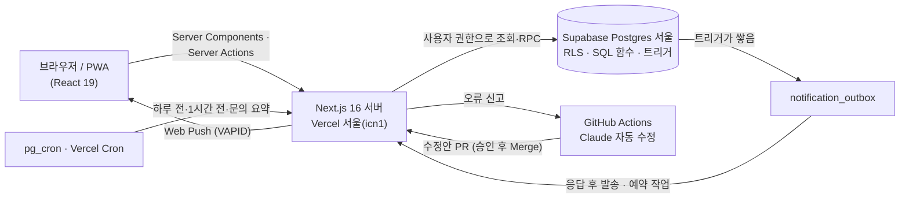

<p align="center">
  
  <br />
  
</p>

<p align="center">
  친구 그룹의 약속을 한곳에 모으고, 누가 오는지 한눈에 보는 모바일 웹앱
  <br />
  <a href="https://jjoin.vercel.app"><b>jjoin.vercel.app</b></a>
</p>

<p align="center">
  
  
  
  
  
  
  
</p>

친구가 많아질수록 약속이 있어도 서로 모르거나, 단톡방에서 "누구 와?"를 매번 다시 묻게 돼요.
**jjoin**은 그룹마다 약속을 올리고, 참여·대기 인원을 바로 보여 주고, 날짜와 장소는 투표로 정하고, 약속이 다가오면 휴대폰으로 알려 줘요.

- **기간**: 2026.10.14 ~ 진행 중 (1인 기획·디자인·개발·운영)
- **사용**: 지인 대상 클로즈드 베타 (가입 15명, 베타 테스터 7명)
- **역할**: 기획, UI, 프론트엔드, DB 설계(RLS·SQL 함수), 서버 기능, 배포·운영, 사용자 테스트

## 화면

| 로그인 | 홈 · 내 약속 | 그룹 |
| :---: | :---: | :---: |
|  |  |  |

| 약속 상세 | 다크 모드 |
| :---: | :---: |
|  |  |

> 스크린샷은 가짜 데이터로 그린 화면이에요. (`src/app/preview/showcase`, 개발 서버에서만 열림)

## 주요 기능

| 영역 | 기능 |
| --- | --- |
| 그룹 | 카카오 로그인, 초대 링크로 참여, 그룹 꾸미기(이모지·색·소개), 새 소식이 있으면 테두리가 도는 스토리형 그룹 목록, 방장 넘기기·내보내기·초대 링크 재발급 |
| 약속 | 카카오맵 장소 검색과 지도·길찾기, **최대 인원과 자동 대기열**, 모집중·마감·종료 상태와 종료 사유, **2박 3일 같은 여러 날 약속**, 남은 날 색 띠 |
| 정하기 | **날짜 투표**(당일: 날짜·시간 후보 / 기간: 가는 날~오는 날 후보), **장소 투표**(카카오맵 후보·투표·확정), 투표 댓글, 확정하면 투표한 사람이 자동 참여 |
| 이야기 | 약속 댓글, `@`언급, 댓글 하트, 안 읽은 댓글 수, **모든 기기에서 같이 맞춰지는 읽음 표시** |
| 공유 | 약속·투표 **공유 링크**(그룹 밖 친구는 그룹에 참여한 뒤 그 화면으로 바로 돌아옴), 카카오톡 링크 미리보기, 구글 캘린더·.ics 내보내기 |
| 알림 | 웹 푸시(새 약속, 대기 승격, 하루 전·1시간 전, 댓글, 언급), 종류별 켜고 끄기, 알림 기록, 약속을 열면 그 약속 알림 자동 읽음 |
| 앱처럼 | PWA 설치, 카카오톡 인앱 브라우저 안내, 당겨서 새로고침, 다크 모드, 화면 전환 애니메이션(View Transitions) |
| 운영 | **문의하기**(유형·화면·기기 정보 자동 첨부), 관리자 화면, 1시간 요약 푸시, **오류 신고 → Claude가 수정안(PR) 작성 → 승인 후 배포**, 회원 탈퇴(그룹·약속을 친구에게 넘기고 정리) |

## 아키텍처



- **권한은 DB가 지켜요.** 모든 표에 Row Level Security를 걸어, 화면 코드가 실수해도 다른 그룹의 데이터는 읽히지 않아요. 여러 단계가 필요한 쓰기(참여·대기열, 투표 확정, 장소 확정, 탈퇴 정리)는 권한을 안에서 확인하는 SQL 함수 하나로 처리해요.
- **알림은 outbox 패턴**이에요. 이벤트가 생기면 DB 트리거가 대기열에 쌓고, 서버가 응답을 보낸 뒤(`after()`) 꺼내 보내요. 예약 알림은 pg_cron이 10분마다 깨워요.
- **상태는 저장하지 않고 계산해요.** 모집중·마감·종료, 남은 날은 참여 인원과 시각으로 그때그때 구해요.

## 기술적 도전과 해결

| 문제 | 원인 | 해결 | 결과 |
| --- | --- | --- | --- |
| 목록↔캘린더 버튼이 "한 번에 안 눌린다"는 제보 | Vercel 함수가 미국 동부, DB는 서울이라 요청마다 태평양 왕복 | 함수 지역을 서울(icn1)로 지정하고, 누르는 즉시 선택 표시(`useLinkStatus`) | 화면 전환 **0.6~1.1초 → 0.2초대 (약 75% 단축)**, 자동화 브라우저로 전후 측정 |
| 정원 1명 약속에 동시에 누르면 초과 참여 | 인원 확인과 저장 사이 경쟁 상태 | `set_participation` 함수에서 약속 행을 `FOR UPDATE`로 잠그고 정원·대기 순번 처리 | 동시에 눌러도 정원 초과 없음, 빠지면 대기 1번 자동 승격 |
| 한글 댓글 마지막 글자가 빠지거나 엔터가 씹힘 | IME 조합 중 엔터·등록이 처리됨 | `compositionend` 이후 전송, 입력칸의 실제 값 사용, 중복 전송 방지 | 수정 전 재현 → 수정 후 3가지 경우 모두 통과 |
| 휴대폰에서 읽은 댓글이 PC에선 안 읽음 | "본 시각"을 브라우저(localStorage)에만 저장 | 사람별 본 시각 표와 서버 시계 기준 기록 함수로 이전 | 두 사용자·두 기기 시나리오 7단계 통과 |
| 공유 링크로 남의 약속을 엿볼 위험 | 링크에 초대 코드를 붙이는 구조 | 초대 코드가 그 약속·투표의 그룹 것인지 서버에서 확인 | 잘못된 코드로는 "볼 수 없어요" |
| 방장이 탈퇴하면 친구들 데이터가 함께 삭제 | 외래 키 연쇄 삭제 | 탈퇴 전 함수가 방장·만든 약속을 넘기고 대기자를 올림 | 세 사용자 탈퇴 시나리오 14항목 통과 |
| 오류 신고 자동 수정의 보안 | 누구나 쓰는 글을 AI가 읽고 코드를 고침 (프롬프트 인젝션) | 문의 글은 "자료"로만, 도구 제한, 금지 경로·변경 크기 상한, PR로만 제출하고 사람이 승인 | 운영 배포는 항상 사람의 Merge를 거침 |

## 품질 관리

- **RLS 침투 시험**: 그룹 밖 계정을 만들어 다른 그룹의 조회·수정·삭제·참여를 모두 시도하고 차단을 확인했어요.
- **자동화 브라우저 시나리오 테스트**: 임시 계정과 데이터를 만들어 실제 화면을 눌러 보고(Chrome DevTools Protocol), 끝나면 모두 지우는 스크립트로 기능마다 검증했어요. 버그는 **수정 전 재현 → 수정 후 통과**로 비교했어요.
- **사용자 테스트**: 베타 테스터 7명이 체크리스트로 152개 항목을 응답, **통과율 98.4%**. 응답은 자동 저장되고, 피드백으로 10여 건을 개선했어요.
- **배포 전 확인**: 타입 검사, ESLint, 프로덕션 빌드 통과 후 배포.

## 기술 스택

| 영역 | 사용 |
| --- | --- |
| 프론트·서버 | Next.js 16 (App Router, Cache Components, Partial Prefetching, Server Actions, View Transitions), React 19, TypeScript |
| 스타일 | Tailwind CSS 4, 라이트·다크 테마 |
| 데이터·인증 | Supabase (Postgres, Row Level Security, SQL 함수·트리거, Auth with Kakao, Storage, pg_cron) |
| 지도 | Kakao Maps JavaScript SDK |
| 알림 | Web Push (VAPID), PWA 서비스 워커 |
| 배포·자동화 | Vercel (서울 지역), GitHub Actions + Claude Code (오류 신고 자동 수정) |

## 규모

| 항목 | 값 |
| --- | --- |
| 커밋 | 87개 (기능 39 · 버그 수정 22), 기능 단위로 나눠 커밋 |
| 화면 | 20개 |
| TypeScript | 약 10,000줄 |
| DB | 마이그레이션 26개 (SQL 약 2,200줄), SQL 함수 40여 개, RLS 정책 40여 개 |

## 앞으로

- **Java Spring 백엔드 분리**: 화면 속도에 영향이 없는 알림 발송 워커 → 예약 작업 → 문의·관리자 API 순서로 옮겨요. 서울 지역 상시 서버(Oracle Cloud Always Free)를 쓰고, Supabase 인증과 RLS는 그대로 유지해요. ([PLAN.md 10장](PLAN.md#10-백엔드-분리-계획-java-spring))
- **문의 기능 다듬기**: 오류 신고 즉시 알림, 우선순위·중복 묶기, 스크린샷 첨부, 답변 스레드. ([PLAN.md 9장](PLAN.md#9-문의-기능-후속-작업))

## 폴더

```
src/
  app/            화면(홈, 그룹, 약속, 투표, 알림, 마이페이지, 문의, 공유)과 Server Actions, API(cron·autofix)
  components/     카드·캘린더·아바타 등 공용 UI
  lib/            데이터 조회, 날짜 계산, 알림 발송, Supabase 클라이언트
supabase/migrations/   DB 스키마·RLS·SQL 함수 (번호 순서대로 실행)
.github/workflows/     오류 신고 자동 수정 (GitHub Actions)
public/           로고, 아이콘, 기본 프로필, 서비스 워커(sw.js), 테스트 체크리스트(test.html)
docs/screenshots/ README 스크린샷
```

<details>
<summary><b>로컬 실행과 운영 설정</b></summary>

### 로컬 실행

1. `.env.example`을 복사해 `.env.local`을 만들고 값을 채워요.
   - Supabase URL·publishable key·secret key, 카카오 JavaScript 키
   - 알림: `npx web-push generate-vapid-keys`로 만든 VAPID 키, 임의의 `CRON_SECRET`
2. Supabase SQL Editor에서 `supabase/migrations`의 SQL을 번호 순서대로 실행해요.
3. 개발 서버를 띄워요.

```bash
npm install
npm run dev
```

http://localhost:3000 에서 확인할 수 있어요. 기획과 진행 단계는 [PLAN.md](PLAN.md)에 있어요.

### 1시간 전 알림 예약 (Supabase pg_cron)

Vercel 무료 플랜의 Cron은 하루 한 번만 돌아서, 1시간 전 알림은 Supabase가 10분마다 서버를 부르게 해요.
Supabase SQL Editor에서 한 번만 실행해요. `<CRON_SECRET>`은 `.env.local`의 값으로 바꿔요. (이 SQL은 비밀 값이 들어가므로 저장소에 넣지 않아요)

```sql
create extension if not exists pg_cron;
create extension if not exists pg_net;

select cron.schedule(
  'jjoin-hour-before',
  '*/10 * * * *',
  $$ select net.http_get(
       url := 'https://jjoin.vercel.app/api/cron/hour-before',
       headers := jsonb_build_object('Authorization', 'Bearer <CRON_SECRET>')
     ); $$
);
```

### 문의 요약 예약 (Supabase pg_cron)

새 문의와 오류 자동 수정 결과를 1시간마다 관리자 휴대폰에 jjoin 푸시 알림으로 모아 보내요. 관리자가 마이페이지에서 "이 기기에서 알림 받기"를 켜 두면 되고, 관리자 화면(`/support/admin`)의 "시험 알림 보내기"로 확인할 수 있어요.

```sql
select cron.schedule(
  'jjoin-inquiry-digest',
  '0 * * * *',
  $$ select net.http_get(
       url := 'https://jjoin.vercel.app/api/cron/inquiry-digest',
       headers := jsonb_build_object('Authorization', 'Bearer <CRON_SECRET>')
     ); $$
);
```

### 오류 신고 자동 수정 (GitHub Actions)

문의하기에 🐞 오류 신고가 들어오면 `.github/workflows/inquiry-autofix.yml`이 Claude로 원인을 찾아 수정안(PR)을 만들어요. PR을 확인하고 Merge해야 운영에 배포돼요.

- GitHub Secrets: `CLAUDE_CODE_OAUTH_TOKEN`(`claude setup-token`으로 만든 구독 토큰), `AUTOFIX_SECRET`
- Vercel 환경 변수: `GITHUB_DISPATCH_TOKEN`(jjoin 저장소 Contents 쓰기 권한 fine-grained 토큰), `AUTOFIX_SECRET`
- 저장소 Settings → Actions → General → Workflow permissions: Read and write + "Allow GitHub Actions to create and approve pull requests"

</details>
