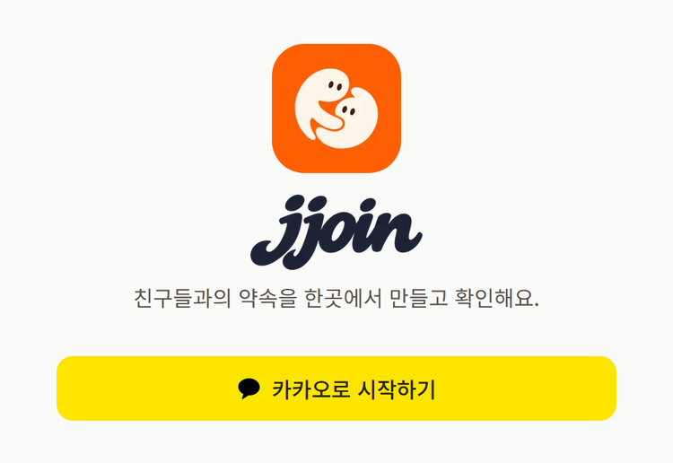
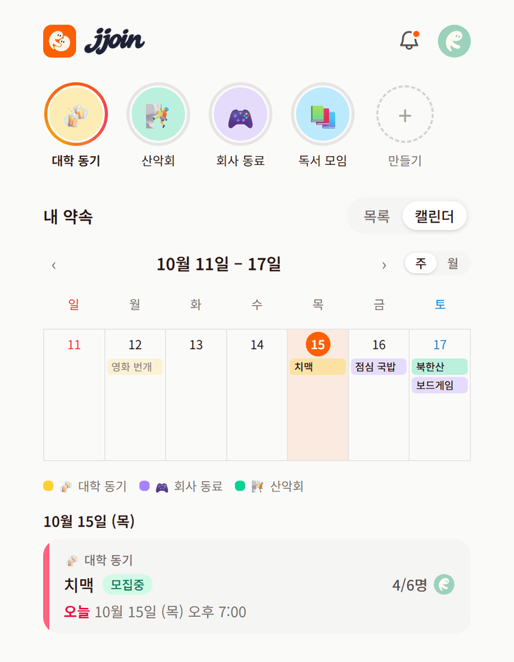
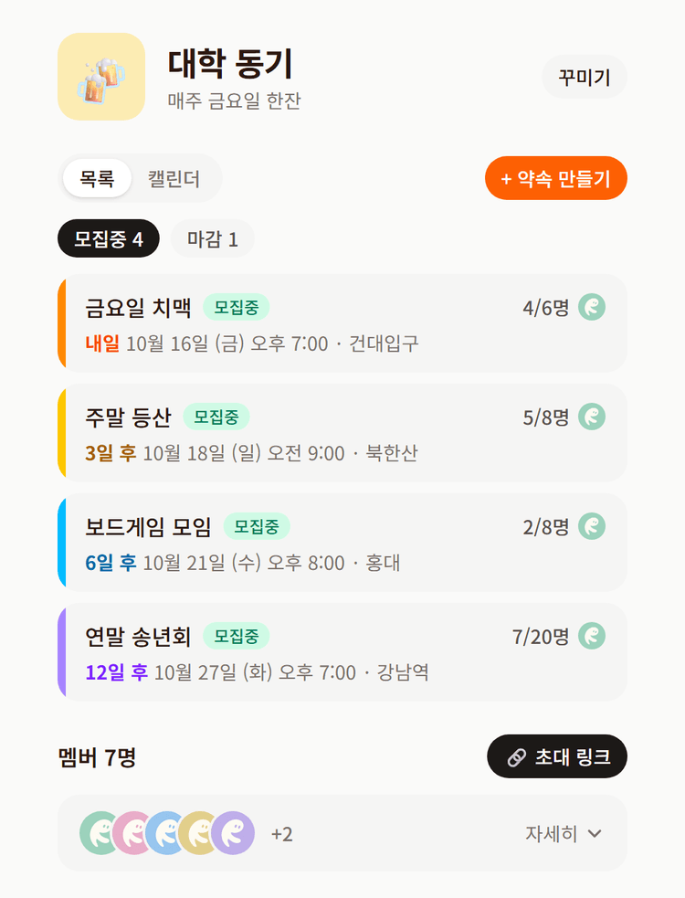
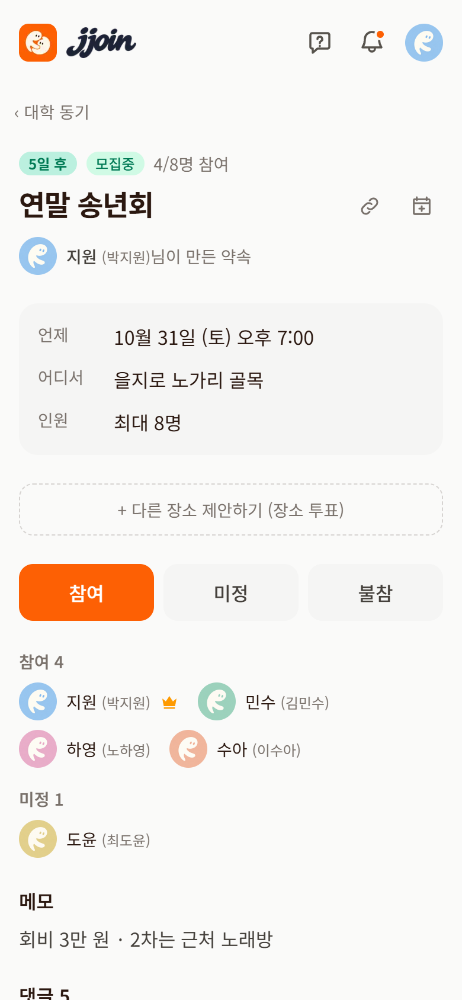
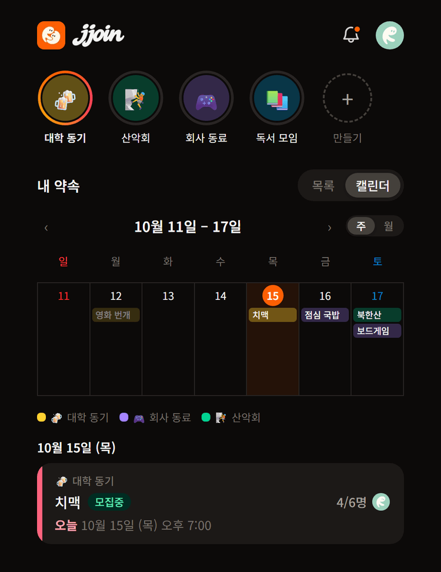

<p align="center">
  
  <br />
  
</p>

<p align="center">
  친구 그룹의 약속을 한곳에 모으고, 누가 오는지 한눈에 보는 모바일 웹앱
  <br />
  <a href="https://jjoin.vercel.app">jjoin.vercel.app</a>
</p>

친구가 많아질수록 약속이 있어도 서로 모르거나 알리기 어려워요.
jjoin은 그룹마다 약속을 올리고, 참여·대기 인원을 실시간으로 보여 주고, 약속이 다가오면 알려 줘요.

## 화면

| 로그인 | 홈 · 내 약속 | 그룹 |
| :---: | :---: | :---: |
|  |  |  |

| 약속 상세 | 다크 모드 |
| :---: | :---: |
|  |  |

> 스크린샷은 가짜 데이터로 그린 화면이에요. (`src/app/preview/showcase`, 개발 서버에서만 열림)

## 주요 기능

### 그룹
- **카카오 로그인** 한 번으로 시작. 닉네임을 바꿔도 카카오 이름이 함께 보여서 누구인지 헷갈리지 않아요.
- **초대 링크**로 친구를 부르고, 그룹마다 이모지·색깔·한 줄 소개로 꾸며요.
- 홈 맨 위에 그룹이 인스타 스토리처럼 동그란 아이콘으로 나란히 보여요. 마지막으로 본 뒤 다른 멤버가 약속을 올리거나 댓글을 단 그룹은 **그라데이션 테두리가 돌고**, 그룹을 열어 보면 꺼져요.
- 멤버 목록은 겹친 프로필 사진으로 접혀 있다가 누르면 펼쳐져요.

### 약속
- **카카오맵 장소 검색**으로 장소를 고르면 상세 화면에 지도와 길찾기가 붙어요.
- **최대 인원과 대기열**: 정원이 차면 대기 순번이 매겨지고, 누가 빠지면 1순위가 자동으로 참여로 올라가요. 여러 명이 동시에 눌러도 DB 행 잠금으로 정원을 넘지 않아요.
- **상태**: 모집중 · 마감 · 종료. 시간이 지나면 "기간 종료"로 자동으로 끝나고, 만든 사람·방장은 사유(인원 미달, 갑작스러운 파토 등)를 골라 미리 종료할 수 있어요.
- **남은 날 표시**: 카드 왼쪽 띠가 보라 → 파랑 → 초록 → 노랑 → 주황 → 빨강으로 다가올수록 따뜻해지고, "오늘 / 내일 / 3일 후"로 알려 줘요.
- **댓글**로 약속마다 이야기를 나누고, `@`로 친구를 부르면 그 친구에게 알림이 가요.
- **날짜 투표**: 날짜를 못 정했으면 후보 날짜를 올리고, 멤버는 되는 날짜에 모두 투표해요. 마감하면 표가 많은 날짜 상위 3개 중 하나로 약속을 확정하고, 그 날짜에 투표한 사람은 자동으로 참여해요.
- **내 캘린더에 추가**: 구글 캘린더 버튼, 아이폰·아웃룩용 캘린더 파일(.ics).
- **링크 미리보기**: 초대·약속 링크를 카카오톡에 보내면 그룹 이름이나 약속 제목·날짜가 담긴 카드가 떠요.

### 보기
- **홈 캘린더**: 내가 참여·대기 중인 약속을 모든 그룹에서 모아 그룹 색으로 보여 줘요. 주 / 월 보기를 골라요.
- **화면 전환 애니메이션**: 화면에 들어가면 오른쪽에서, 뒤로 가면 왼쪽에서 넘어오고, 목록 ↔ 캘린더나 주·달 넘김도 옆 페이지처럼 움직여요. (View Transitions)
- 그룹 화면은 모집중 / 마감 / 종료 필터로 걸러 봐요.

### 앱처럼
- **PWA**: 홈 화면에 설치하면 주소창 없이 앱처럼 열려요.
- **알림(웹 푸시)**: 새 약속, 대기 승격, 약속 하루 전·1시간 전, 새 댓글, 댓글 언급. 종류별로 켜고 끌 수 있어요. (아이폰은 홈 화면에 설치한 앱에서)
- **그룹 관리**: 방장은 방장 넘기기, 멤버 내보내기, 초대 링크 새로 만들기, 그룹 삭제를 할 수 있어요.
- **알림 기록**: 홈 오른쪽 위 🔔에서 지난 알림을 모아 봐요. 안 읽은 알림이 있으면 점이 찍혀요.
- **다크 모드**: 시스템 설정 / 라이트 / 다크 선택. 처음 그릴 때부터 적용돼 깜빡이지 않아요.
- **프로필**: 사진을 올리거나, 사진이 없으면 6가지 색 파스텔 유령 중 하나로.

## 기술 스택

| 영역 | 사용 |
| --- | --- |
| 프론트·서버 | Next.js 16 (App Router, Cache Components, Server Actions, View Transitions), React 19, TypeScript |
| 스타일 | Tailwind CSS 4 |
| 데이터·인증 | Supabase (Postgres, Row Level Security, Auth with Kakao, Storage) |
| 지도 | Kakao Maps JavaScript SDK (장소 검색) |
| 알림 | Web Push (VAPID, `web-push`), Vercel Cron |
| 배포 | Vercel |

## 구조 한눈에 보기

```
브라우저 ──(Server Actions)──▶ Next.js 서버 ──▶ Supabase Postgres
   ▲                               │                 │ RLS: 같은 그룹 멤버만 조회
   │ 웹 푸시                        │                 │ RPC: 참여·대기열(행 잠금)
   └──────── 알림 발송 ◀── after() · Cron ◀── notification_outbox (DB 트리거가 쌓음)
```

- **권한은 DB가 지켜요.** 모든 테이블에 RLS가 걸려 있어서, 화면 코드가 실수해도 다른 그룹의 데이터는 읽히지 않아요.
- **참여와 대기열은 RPC 하나**(`set_participation`)에서 약속 행을 잠그고 처리해요.
- **알림은 outbox 패턴**: 새 약속·대기 승격이 생기면 DB 트리거가 `notification_outbox`에 쌓고, 서버가 응답 후(`after()`) 비밀 키로 꺼내 보내요. 하루 전 알림은 매일 오전 10시 Vercel Cron이 쌓고 보내요.
- 상태(모집중·마감·종료)와 남은 날은 저장하지 않고 참여 인원과 시각으로 계산해요.

## 폴더

```
src/
  app/            화면 (홈, 그룹, 약속, 마이페이지, 초대, 로그인) 과 Server Actions
  components/     카드·캘린더·아바타 등 공용 UI
  lib/            데이터 조회, 날짜 계산, 알림 발송, Supabase 클라이언트
supabase/migrations/   DB 스키마·RLS·RPC (0001 ~ 0014, 순서대로 실행)
public/           로고, 아이콘, 기본 프로필, 서비스 워커(sw.js)
design/           원본 이미지 (배포에 포함되지 않음)
docs/screenshots/ README 스크린샷
```

## 로컬 실행

1. `.env.example`을 복사해 `.env.local`을 만들고 값을 채워요.
   - Supabase URL·publishable key·secret key, 카카오 JavaScript 키
   - 알림: `npx web-push generate-vapid-keys`로 만든 VAPID 키, 임의의 `CRON_SECRET`
2. Supabase SQL Editor에서 `supabase/migrations`의 SQL을 번호 순서대로 실행해요.
3. 개발 서버를 띄워요.

```bash
npm install
npm run dev
```

http://localhost:3000 에서 확인할 수 있어요. 기획과 진행 단계는 [PLAN.md](PLAN.md)에 있어요.

### 1시간 전 알림 예약 (Supabase pg_cron)

Vercel 무료 플랜의 Cron은 하루 한 번만 돌아서, 1시간 전 알림은 Supabase가 10분마다 서버를 부르게 해요.
Supabase SQL Editor에서 한 번만 실행해요. `<CRON_SECRET>`은 `.env.local`의 값으로 바꿔요. (이 SQL은 비밀 값이 들어가므로 저장소에 넣지 않아요)

```sql
create extension if not exists pg_cron;
create extension if not exists pg_net;

select cron.schedule(
  'jjoin-hour-before',
  '*/10 * * * *',
  $$ select net.http_get(
       url := 'https://jjoin.vercel.app/api/cron/hour-before',
       headers := jsonb_build_object('Authorization', 'Bearer <CRON_SECRET>')
     ); $$
);
```
