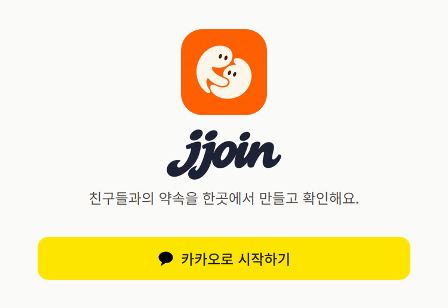
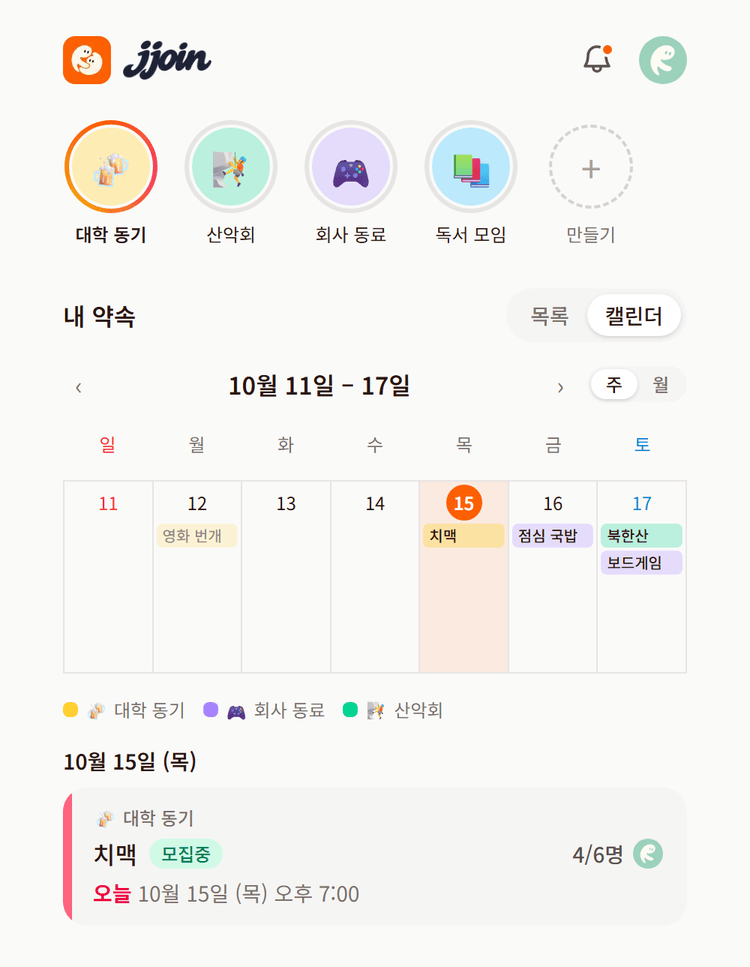
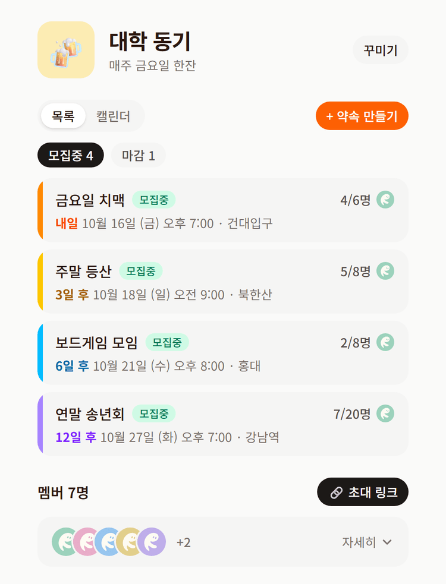
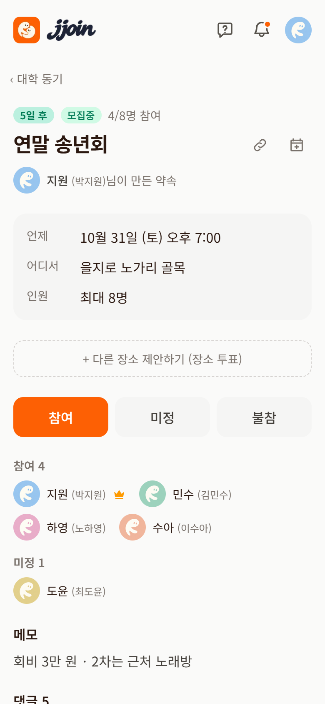
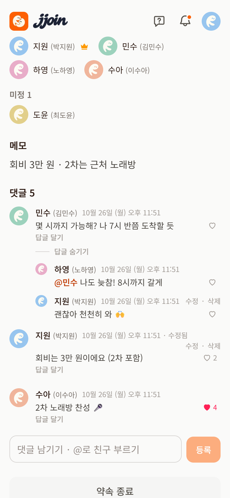
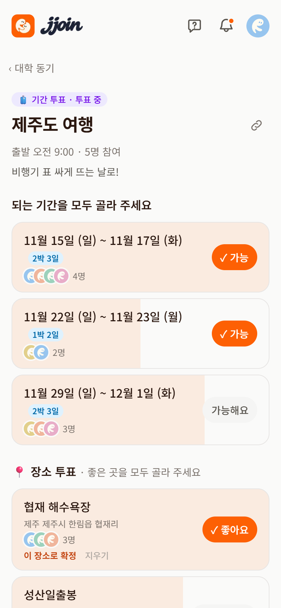
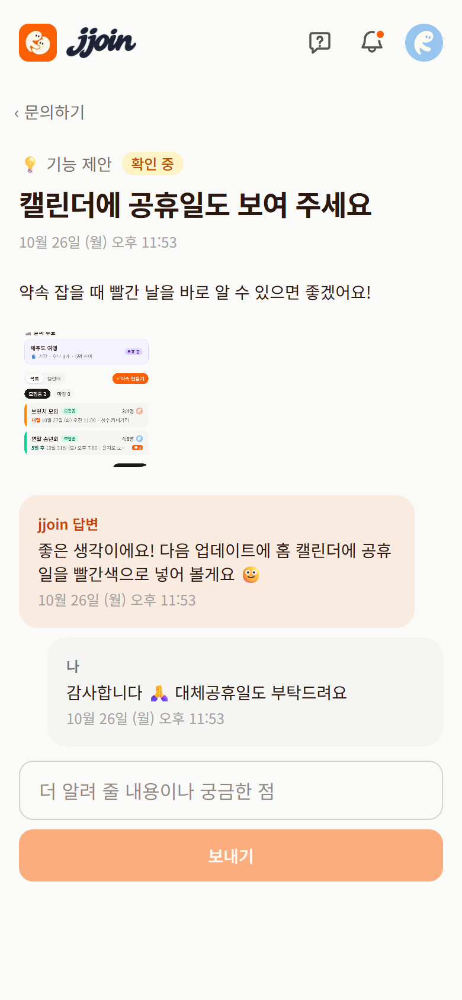
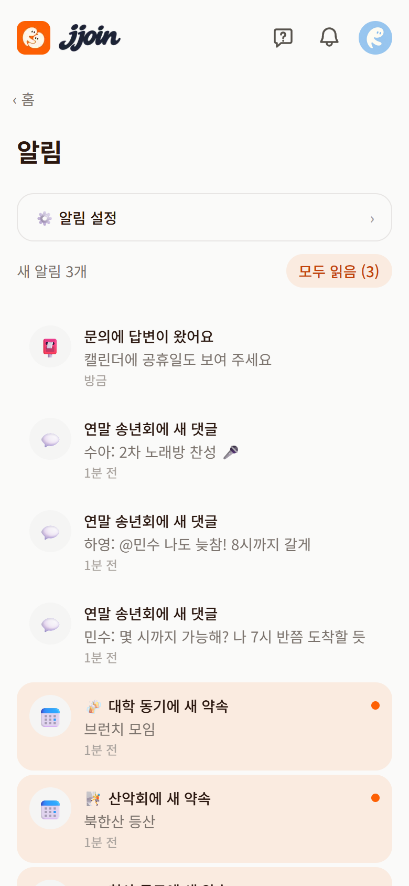
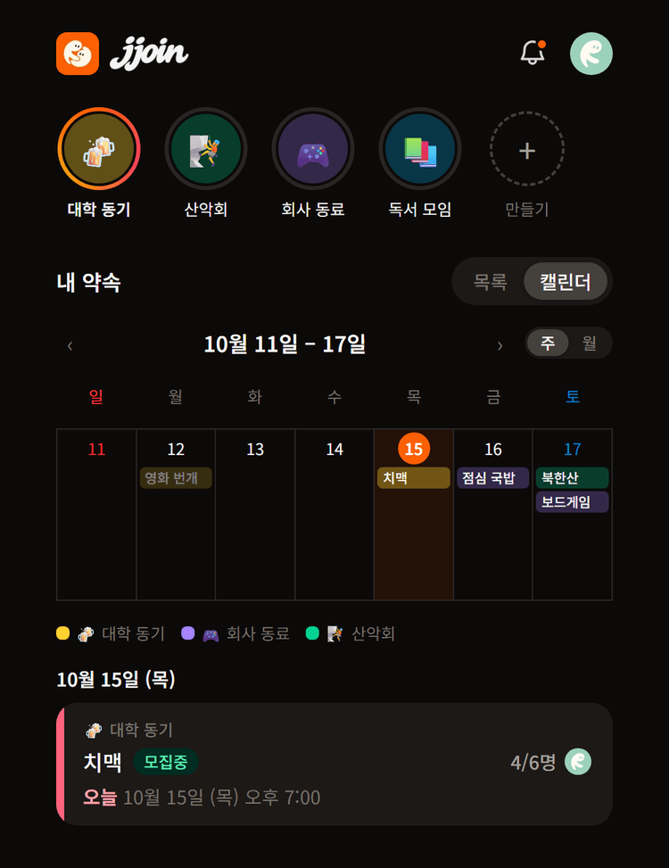
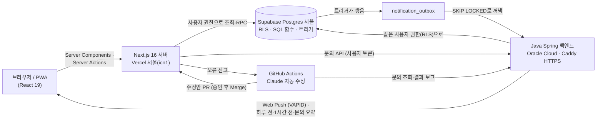

<p align="center">
  
  <br />
  
</p>

<p align="center">
  친구 그룹의 약속을 한곳에 모으고, 누가 오는지 한눈에 보는 모바일 웹앱
  <br />
  <a href="https://jjoin.vercel.app"><b>jjoin.vercel.app</b></a>
</p>

<p align="center">
  
  
  
  
  
  
  
  
</p>

친구가 많아질수록 약속이 있어도 서로 모르거나, 단톡방에서 "누구 와?"를 매번 다시 묻게 돼요.
**jjoin**은 그룹마다 약속을 올리고, 참여·대기 인원을 바로 보여 주고, 날짜와 장소는 투표로 정하고, 약속이 다가오면 휴대폰으로 알려 줘요.

- **기간**: 2026.10.14 ~ 진행 중 (1인 기획·디자인·개발·운영)
- **사용**: 지인 대상 클로즈드 베타 (가입 23명, 베타 테스터 7명)
- **역할**: 기획, UI, 프론트엔드, DB 설계(RLS·SQL 함수), Java Spring 백엔드, 배포·운영, 사용자 테스트

## 화면

| 로그인 | 홈 · 내 약속 | 그룹 |
| :---: | :---: | :---: |
|  |  |  |

| 약속 상세 | 댓글 (답글·하트·@언급) | 여러 날 약속 투표 |
| :---: | :---: | :---: |
|  |  |  |

| 문의 대화 | 알림 | 다크 모드 |
| :---: | :---: | :---: |
|  |  |  |

> 시험 계정과 가짜 데이터로 실제 앱에서 찍은 화면이에요. 이름 옆 (카톡 이름)은 그 그룹의 방장에게만 보여요. 광고 배너는 지우고 찍었어요.

## 주요 기능

| 영역 | 기능 |
| --- | --- |
| 그룹 | 카카오 로그인, 초대 링크로 참여, 그룹 꾸미기(이모지·색·소개), 새 소식이 있으면 테두리가 도는 스토리형 그룹 목록, 방장 넘기기·내보내기·초대 링크 재발급, 모르는 사람을 알아보도록 **카톡 이름은 그 그룹 방장에게만**(DB 열 권한으로 막음) |
| 약속 | 카카오맵 장소 검색과 지도·길찾기, **최대 인원과 자동 대기열**, 모집중·마감·종료 상태와 종료 사유, **2박 3일 같은 여러 날 약속**, 남은 날 색 띠, 공휴일을 빨간날로 보여 주는 주·월 캘린더(관보 기준, 대체·임시공휴일 포함) |
| 정하기 | **날짜 투표**(당일: 날짜·시간 후보 / 기간: 가는 날~오는 날 후보), **장소 투표**(카카오맵 후보·투표·확정), 후보를 누르면 고른 사람 이름이 펼쳐짐, 확정하면 투표한 사람이 자동 참여하고 투표 때 나눈 댓글도 약속으로 이어짐 |
| 이야기 | 약속·투표 댓글(**같은 표 하나, 같은 기능**): 답글, `@`언급, 하트, 수정, 새 댓글·언급 알림, 안 읽은 댓글 수, **모든 기기에서 같이 맞춰지는 읽음 표시** |
| 공유 | 약속·투표 **공유 링크**(그룹 밖 친구는 그룹에 참여한 뒤 그 화면으로 바로 돌아옴), 카카오톡 링크 미리보기, 구글 캘린더·.ics 내보내기 |
| 알림 | 웹 푸시(새 약속, 대기 승격, 하루 전·1시간 전, 댓글, 언급), 종류별 켜고 끄기, 알림 기록, 약속을 열면 그 약속 알림 자동 읽음 |
| 앱처럼 | PWA 설치, 카카오톡 인앱 브라우저 안내, 당겨서 새로고침, 다크 모드, 화면 전환 애니메이션(View Transitions) |
| 운영 | **문의하기**(스크린샷·대화·우선순위·중복 묶기), 오류 신고 즉시 푸시와 1시간 요약, **오류 신고 → Claude가 수정안(PR) 작성 → 승인 후 배포 → 문의 자동 처리 완료**, 화면 오류·느린 로딩 자동 기록과 문제 해결 팝업, 회원 탈퇴(그룹·약속을 친구에게 넘기고 정리) |

## 아키텍처



- **권한은 DB가 지켜요.** 모든 표에 Row Level Security를 걸어, 화면 코드가 실수해도 다른 그룹의 데이터는 읽히지 않아요. 여러 단계가 필요한 쓰기(참여·대기열, 투표 확정, 장소 확정, 탈퇴 정리)는 권한을 안에서 확인하는 SQL 함수 하나로 처리해요.
- **알림은 outbox 패턴**이에요. 이벤트가 생기면 DB 트리거가 대기열에 쌓고, Spring 워커가 꺼내 보내요. 예약 알림(하루 전·1시간 전)과 문의 요약도 Spring이 맡아요.
- **화면에 영향 없는 일부터 Spring으로** 옮겼어요. 사용자 요청은 Supabase 로그인 토큰을 그대로 검증하고, DB에는 그 사용자 권한으로 접속해 RLS를 그대로 써요. 권한 규칙을 두 군데에 나눠 짜지 않아요.
- **상태는 저장하지 않고 계산해요.** 모집중·마감·종료, 남은 날은 참여 인원과 시각으로 그때그때 구해요.

## Java Spring 백엔드

화면 응답과 상관없는 "뒤에서 도는 일"과 문의 API를 Next.js에서 떼어 Spring 백엔드로 옮겼어요. Oracle Cloud 무료 상시 서버(오사카)에서 운영 중이에요. 자세한 설계와 테스트는 [backend/README.md](backend/README.md)에 있어요.

| 무엇 | 어떻게 | 확인 |
| --- | --- | --- |
| 알림 중복 발송 방지 | DB 트리거가 쌓은 대기열(outbox)을 `FOR UPDATE SKIP LOCKED`로 꺼냄 | 워커 4개가 동시에 200건을 꺼내도 중복 0건 (통합 테스트) |
| 일시 실패 재시도 | 429·5xx·네트워크 실패는 30초부터 두 배씩 늘려 최대 5번, 한 기기라도 받으면 재발송 안 함 | 운영 대기열 기록상 실패 0건 |
| 예약 작업 한 번만 | `@Scheduled` + Postgres advisory lock, 여러 서버에서도 한 곳만 실행 | 다른 워커가 잡고 있으면 건너뜀 (통합 테스트) |
| 문의 API (B3) | Supabase JWT(ES256, 공개 JWKS)를 검증하고, 트랜잭션마다 `set local role authenticated` + JWT claims로 기존 RLS를 그대로 적용 | 운영 DB 쿼리 통계에서 Spring SQL이 `authenticated` 역할로 실행된 것 확인 |
| HTTPS 입구 | Caddy가 인증서를 자동 발급(sslip.io), 서버 상태 정보(`/actuator`)는 바깥에 막음. 배포 워크플로가 설정 파일·`.env`·방화벽까지 맞춤 | 배포마다 인증 없는 요청이 401인지 확인 |
| 설정 누락 방지 | 설정이 빠지면 조용히 0건씩 돌지 않고 시작할 때 멈춤 | 실제 `application.yaml`을 묶어 보는 테스트 |
| 자동 배포 | 테스트 58개 통과 → x86·ARM 이미지(GHCR) → SSH로 서버 반영 | GitHub Actions "백엔드 배포" |
| 되돌리기 | Vercel 환경 변수(`CRON_WORKER`, `INQUIRY_API`)나 Secret(`AUTOFIX_API_URL`)만 지우면 Next가 다시 맡음. 알림 발송은 워커 전용 (Next 예비 경로는 나간 사람 확인·재시도가 없어 지움) | 둘이 같이 돌아도 중복 발송 없음 |

## 개발 방식

| 무엇 | 어떻게 |
| --- | --- |
| 할 일 관리 | [GitHub 프로젝트](https://github.com/users/jxxngin/projects/1) 보드: 백로그 → 할 일 → 진행 중 → 머지 대기 → 완료, 우선순위·단계 필드. 확정된 일은 이슈, 아이디어는 초안 카드 |
| 변경은 모두 PR로 | 이슈 → 브랜치 → PR(`Closes #번호`) → 직접 리뷰·머지. main은 Ruleset으로 보호(직접 푸시·강제 푸시 금지, 프론트 빌드 통과 필수, Squash만, 머지하면 브랜치 자동 삭제) |
| 라벨 | 종류(`feat`·`fix`·`refactor`…), 영역(`area: frontend/backend/db`), 출처(`from: 문의/화면 오류/베타`) |
| AI와 함께 | Claude Code로 구현하고, 운영 DB·저장소 설정처럼 PR로 남지 않는 변경은 설정안을 먼저 보고 승인한 뒤 적용 |
| 의존성 | 공휴일 데이터만 Dependabot이 매주 확인해 새 버전이 있으면 PR |
| 피드백 | 매 작업 시작 때 문의·화면 오류 기록·베타 테스트 결과를 먼저 확인하고 고칠 게 있으면 PR |

## 기술적 도전과 해결

| 문제 | 원인 | 해결 | 결과 |
| --- | --- | --- | --- |
| 목록↔캘린더 버튼이 "한 번에 안 눌린다"는 제보 | Vercel 함수가 미국 동부, DB는 서울이라 요청마다 태평양 왕복 | 함수 지역을 서울(icn1)로 지정하고, 누르는 즉시 선택 표시(`useLinkStatus`) | 화면 전환 **0.6~1.1초 → 0.2초대 (약 75% 단축)**, 자동화 브라우저로 전후 측정 |
| 정원 1명 약속에 동시에 누르면 초과 참여 | 인원 확인과 저장 사이 경쟁 상태 | `set_participation` 함수에서 약속 행을 `FOR UPDATE`로 잠그고 정원·대기 순번 처리 | 동시에 눌러도 정원 초과 없음, 빠지면 대기 1번 자동 승격 |
| 한글 댓글 마지막 글자가 빠지거나 엔터가 씹힘 | IME 조합 중 엔터·등록이 처리됨 | `compositionend` 이후 전송, 입력칸의 실제 값 사용, 중복 전송 방지 | 수정 전 재현 → 수정 후 3가지 경우 모두 통과 |
| 휴대폰에서 읽은 댓글이 PC에선 안 읽음 | "본 시각"을 브라우저(localStorage)에만 저장 | 사람별 본 시각 표와 서버 시계 기준 기록 함수로 이전 | 두 사용자·두 기기 시나리오 7단계 통과 |
| 공유 링크로 남의 약속을 엿볼 위험 | 링크에 초대 코드를 붙이는 구조 | 초대 코드가 그 약속·투표의 그룹 것인지 서버에서 확인 | 잘못된 코드로는 "볼 수 없어요" |
| 방장이 탈퇴하면 친구들 데이터가 함께 삭제 | 외래 키 연쇄 삭제 | 탈퇴 전 함수가 방장·만든 약속을 넘기고 대기자를 올림 | 세 사용자 탈퇴 시나리오 14항목 통과 |
| 약속 댓글과 투표 댓글의 기능이 달라짐 | 두 표·두 벌의 코드로 따로 만들어, 한쪽만 고쳐지고 알림 기록 표는 약속만 담을 수 있었음 | 표 하나(`comments`)로 합치고 기존 댓글을 id 그대로 옮김. 투표가 확정되면 트리거로 댓글을 약속으로 옮김 | 투표 댓글에도 하트·알림 기록·새 댓글 알림·안 읽은 수, 이후 댓글 기능은 한 곳만 수정 |
| 오류 신고 자동 수정의 보안 | 누구나 쓰는 글을 AI가 읽고 코드를 고침 (프롬프트 인젝션) | 문의 글은 "자료"로만, 도구 제한, 금지 경로·변경 크기 상한, PR로만 제출하고 사람이 승인 | 운영 배포는 항상 사람의 Merge를 거침 |

## 품질 관리

- **RLS 침투 시험**: 그룹 밖 계정을 만들어 다른 그룹의 조회·수정·삭제·참여를 모두 시도하고 차단을 확인했어요.
- **자동화 브라우저 시나리오 테스트**: 임시 계정과 데이터를 만들어 실제 화면을 눌러 보고(Chrome DevTools Protocol), 끝나면 모두 지우는 스크립트로 기능마다 검증했어요. 버그는 **수정 전 재현 → 수정 후 통과**로 비교했어요.
- **사용자 테스트**: 베타 테스터 7명이 단계별 체크리스트에 177건을 응답했고, 판정할 수 있었던 142건 중 140건이 통과해 **통과율 98.6%**예요. 응답은 자동 저장되고, 피드백으로 10여 건을 개선했어요. ("못 해봄" 35건은 혼자 확인하기 어려운 알림·대기열·투표 확정에 몰려, 여러 계정을 쓰는 시나리오 테스트로 보완해요)
- **배포 전 확인**: 타입 검사, ESLint, 프로덕션 빌드 통과 후 배포.

## 기술 스택

| 영역 | 사용 |
| --- | --- |
| 프론트·서버 | Next.js 16 (App Router, Cache Components, Partial Prefetching, Server Actions, View Transitions), React 19, TypeScript |
| 스타일 | Tailwind CSS 4, 라이트·다크 테마 |
| 데이터·인증 | Supabase (Postgres, Row Level Security, SQL 함수·트리거, Auth with Kakao, Storage, pg_cron) |
| 지도 | Kakao Maps JavaScript SDK |
| 알림 | Web Push (VAPID), PWA 서비스 워커 |
| 백엔드 | Java 21, Spring Boot 4.1, Spring Security(OAuth2 Resource Server), JdbcClient, JUnit 5 · Testcontainers, Docker (알림 발송 워커 · 예약 작업 · 문의 API) |
| 배포·자동화 | Vercel (서울 지역), Oracle Cloud(오사카) + GHCR + Caddy (백엔드), GitHub Actions + Claude Code (오류 신고 자동 수정), Dependabot |
| 협업 도구 | GitHub Projects, Issues·PR·라벨, Ruleset |

## 규모

| 항목 | 값 |
| --- | --- |
| 커밋 | 138개 (기능 59 · 수정 33), 기능 단위로 나눠 커밋 |
| 백엔드 테스트 | 58개 (단위 + PostgreSQL 통합), 통과해야 배포 |
| 운영 배포 | Vercel 59회 중 58회 성공 (2026-10-14 ~ 11-07) |
| 화면 | 21개 |
| TypeScript | 약 11,900줄 |
| Java | 약 1,800줄 |
| DB | 마이그레이션 35개 (SQL 약 2,800줄), SQL 함수 55개, RLS 정책 73개 |

## 앞으로

[GitHub 프로젝트 보드](https://github.com/users/jxxngin/projects/1)에서 관리해요.

- **Java Spring 백엔드**: 알림 발송 워커(B1), 예약 작업(B2), 문의·관리자 API와 자동 수정 연동(B3)까지 운영 중이에요. 약속·투표 읽기·쓰기(B4)는 서버가 안정된 뒤 필요할 때만 옮겨요. ([PLAN.md 10장](PLAN.md#10-백엔드-분리-계획-java-spring))
- **기능**: 약속 사진 앨범, 카카오톡 공유하기 SDK, 반복 약속, N빵 정산 (백로그)

## 폴더

```
frontend/              Next.js 웹앱 (Vercel)
  src/app/             화면(홈, 그룹, 약속, 투표, 알림, 마이페이지, 문의, 공유)과 Server Actions, API(cron·autofix)
  src/components/      카드·캘린더·아바타 등 공용 UI
  src/lib/             데이터 조회, 날짜 계산, 알림 발송, Supabase 클라이언트
  public/              로고, 아이콘, 기본 프로필, 서비스 워커(sw.js), 테스트 체크리스트(test.html)
backend/               Java Spring 백엔드 (알림 발송 워커 · 예약 작업 · 문의 API) → backend/README.md
supabase/migrations/   DB 스키마·RLS·SQL 함수 (번호 순서대로 실행, 프론트·백엔드 공용)
.github/workflows/     오류 신고 자동 수정, 고친 문의 배포 처리, 백엔드 테스트·배포 (GitHub Actions)
.github/dependabot.yml 공휴일 데이터 업데이트 PR
design/                로고·기본 프로필 원본
docs/screenshots/      README 스크린샷
```

<details>
<summary><b>로컬 실행과 운영 설정</b></summary>

### 로컬 실행

1. `frontend/.env.example`을 복사해 `frontend/.env.local`을 만들고 값을 채워요.
   - Supabase URL·publishable key·secret key, 카카오 JavaScript 키
   - 알림: `npx web-push generate-vapid-keys`로 만든 VAPID 키, 임의의 `CRON_SECRET`
2. Supabase SQL Editor에서 `supabase/migrations`의 SQL을 번호 순서대로 실행해요.
3. 개발 서버를 띄워요.

```bash
cd frontend
npm install
npm run dev
```

> Windows 보안 정책(Application Control)이 Next의 기본 빌드 도구(SWC)를 막는 PC에서는 `JJOIN_WEBPACK=1 npx next dev --webpack`으로 띄워요.

http://localhost:3000 에서 확인할 수 있어요. 기획과 진행 단계는 [PLAN.md](PLAN.md)에 있어요.

### Java Spring 백엔드

서버 만들기, 자동 배포, Next에서 넘겨받기(`CRON_WORKER`·`INQUIRY_API`), HTTPS 입구, 되돌리기는 [backend/DEPLOY.md](backend/DEPLOY.md)에 있어요. Spring이 예약 작업을 맡으면(`CRON_WORKER=spring`) 아래 두 pg_cron 설정은 필요 없어요. (Next의 Cron 주소가 "쉼"으로 답해요)

### 1시간 전 알림 예약 (Supabase pg_cron)

Vercel 무료 플랜의 Cron은 하루 한 번만 돌아서, 1시간 전 알림은 Supabase가 10분마다 서버를 부르게 해요.
Supabase SQL Editor에서 한 번만 실행해요. `<CRON_SECRET>`은 `frontend/.env.local`의 값으로 바꿔요. (이 SQL은 비밀 값이 들어가므로 저장소에 넣지 않아요)

```sql
create extension if not exists pg_cron;
create extension if not exists pg_net;

select cron.schedule(
  'jjoin-hour-before',
  '*/10 * * * *',
  $$ select net.http_get(
       url := 'https://jjoin.vercel.app/api/cron/hour-before',
       headers := jsonb_build_object('Authorization', 'Bearer <CRON_SECRET>')
     ); $$
);
```

### 문의 요약 예약 (Supabase pg_cron)

새 문의와 오류 자동 수정 결과를 1시간마다 관리자 휴대폰에 jjoin 푸시 알림으로 모아 보내요. 관리자가 알림 화면의 ⚙️ 알림 설정에서 "이 기기에서 알림 받기"를 켜 두면 되고, 관리자 화면(`/support/admin`)의 "시험 알림 보내기"로 확인할 수 있어요.

```sql
select cron.schedule(
  'jjoin-inquiry-digest',
  '0 * * * *',
  $$ select net.http_get(
       url := 'https://jjoin.vercel.app/api/cron/inquiry-digest',
       headers := jsonb_build_object('Authorization', 'Bearer <CRON_SECRET>')
     ); $$
);
```

### 오류 신고 자동 수정 (GitHub Actions)

문의하기에 🐞 오류 신고가 들어오면 `.github/workflows/inquiry-autofix.yml`이 Claude로 원인을 찾아 수정안(PR)을 만들어요. PR을 확인하고 Merge해야 운영에 배포돼요.

- GitHub Secrets: `CLAUDE_CODE_OAUTH_TOKEN`(`claude setup-token`으로 만든 구독 토큰), `AUTOFIX_SECRET`, (Spring으로 보낼 때) `AUTOFIX_API_URL`
- Vercel 환경 변수: `GITHUB_DISPATCH_TOKEN`(jjoin 저장소 Contents 쓰기 권한 fine-grained 토큰), `AUTOFIX_SECRET`
- 저장소 Settings → Actions → General → Workflow permissions: Read and write + "Allow GitHub Actions to create and approve pull requests"
- 자동 수정은 24시간에 3건까지 돌고, 넘으면 관리자가 문의 화면에서 직접 다시 실행해요.

### 고친 문의 자동 처리 완료

커밋 메시지에 `Inquiry: <문의 번호>` 줄을 넣으면, Vercel 운영 배포가 끝날 때 `.github/workflows/inquiry-deployed.yml`이 그 문의(와 같은 문의로 묶인 문의)를 처리 완료로 바꾸고 문의한 사람에게 알려요. 자동 수정 PR에는 이 줄이 저절로 들어가요. (GitHub Secret `AUTOFIX_SECRET` 필요)

</details>
